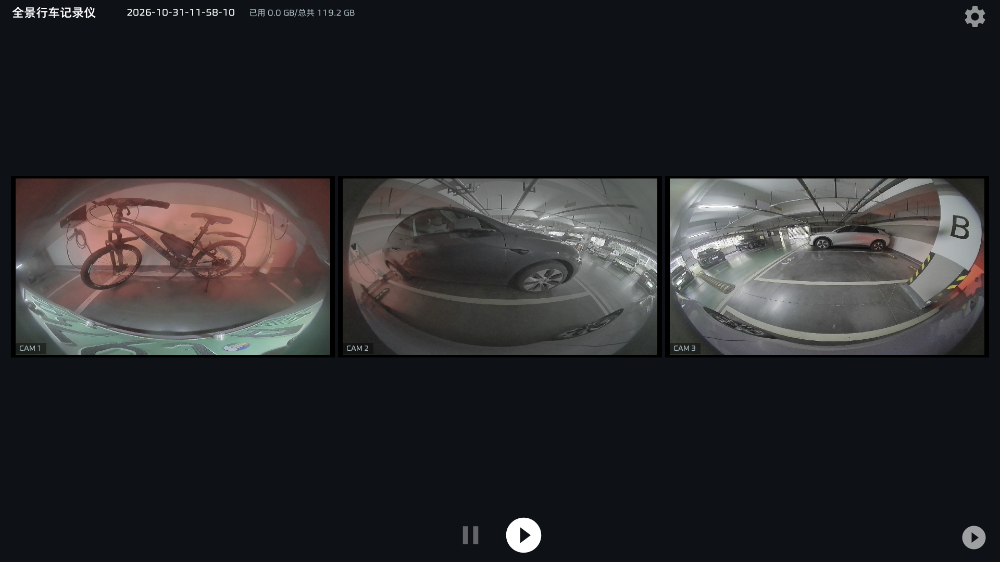
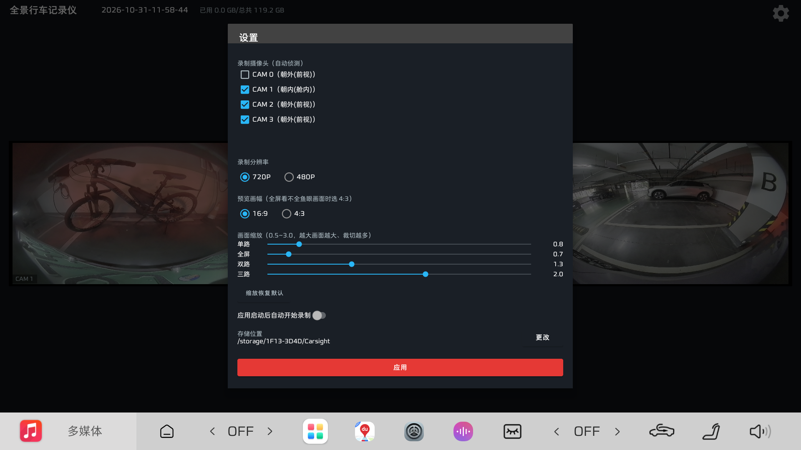

# MG4 全景行车记录仪

面向骁龙 8155（arm64-v8a）车机平台的多路全景行车记录仪 Android 应用，支持 Android 9.0（API 28）及以上。

多路鱼眼摄像头实时预览 + HEVC 硬件编码录制，录像存于外挂 USB 硬盘，内置回放播放器。

## 界面截图

**主界面**（三路鱼眼实时预览，标题栏含实时时间与存储容量）：



**设置面板**（摄像头勾选、分辨率、预览画幅、分档缩放滑块、存储位置）：



---

## 功能特性

### 录制
- **多路同时录制**：摄像头自动侦测（cameraID / 朝向 / 数量动态枚举，无需硬编码），在设置中按 ID 勾选，可 1~4 路同时录制
- **HEVC 硬件编码**：MediaCodec Surface 零拷贝硬编（8155 上命中 c2.qti.hevc.encoder，与 ffmpeg 硬编同路径），设备无 HEVC 编码器时自动回退 H.264；MP4 封装
- **分辨率可选**：720P / 480P（自动匹配 HAL 支持的最近尺寸）
- **动态码率**：低分辨率分析流做帧间差分运动检测，码率 1.2~3Mbps 自适应（CBR）
- **2 分钟自动分段**：单文件 ≤ 2 分钟，编码器不重启、无缝切分
- **文件命名**：`CAM<cameraID>-<录制起始时间>.mp4`，时间精确到秒（纯数字 `年-月-日-时-分-秒`），如 `CAM1-2026-10-30-22-55-03.mp4`，文件名即实现时间追溯
- **循环写入**：开启新分段前检查剩余容量，不足 1GB 时自动从各摄像头目录删除文件名最早（时间最早）的录像，直至空间达标；每个目录始终保留最新的 1 个文件
- **断电安全落盘**：分段写入 `.part` 临时文件并每 2 秒强制 `fd.sync()` 落盘（断电最多丢最近约 2 秒数据）；分段正常收尾才改名为 `.mp4`，异常断电/死机/强杀只残留 `.part`（下次启动自动清理），回放列表中出现的永远是完整可播放的文件
- **标题栏实时时间**：主界面标题"全景行车记录仪"旁显示系统实时时间（精确到秒，每秒刷新）
- **存储容量显示**：时间旁显示"已用 xx GB/总共 xx GB"，在 App 启动、开启新分段文件前（循环写入清理后）、停止录制后刷新
- **录制容错**：单路会话配置失败自动降级重试（全量流 → 去分析流 → 仅录制流）；断线重连限次退避；帧错误看门狗；单路故障不影响其它路与 App 本身
- **后台保活录制**：录制期间运行前台服务（常驻通知，camera 类型；START_STICKY 被杀自动拉起），切入后台多路采集不中断
- **后台省电与防误报**：未录制状态下切入后台 3 秒后自动释放全部摄像头，回到前台自动重新获取；App 在后台期间的摄像头错误不再弹出气泡提示
- **延时自动录制**：开启"启动自动录制"后，App 启动延时 3 秒（等待多路摄像头就绪、避开启动期硬件负载高峰）再自动开录，避免部分 cam 因负载过高打开失败

### 预览与显示
- 16:9 自适应预览网格，多路时自动排布并缩放到一页内（无空洞布局）
- 传感器方向自动校正 + 前置镜像；车机实测旋转校准量可调
- **分档画面缩放**：单路 / 全屏 / 双路 / 三路四个独立倍率，可在设置中滑块调节（0.5~3.0），适配不同鱼眼镜头视野；恢复默认一键重置
- **预览画幅可选**：16:9 / 4:3（部分鱼眼 HAL 的完整圆画面只在 4:3 缓冲内）
- 点击任意预览格进入该路**全屏预览**，录制中切换不影响编码流
- 沉浸式全屏（隐藏状态栏/导航栏）；针对无手势返回的车机，各界面左上角均带半透明返回按钮

### 存储
- 支持**外挂 USB 硬盘**（targetSdk 29 + 传统存储视图直连，不依赖 SAF，Android 11 车机稳定）
- App 内**文件夹浏览器**选择存储位置：顶层列出所有挂载卷（`/proc/mounts` 解析 + 系统卷枚举双通道，兼容硬盘 UUID 随机变化如 `/storage/1F13-3D4D`），支持逐级进入/返回、新建文件夹、长按路径手动输入兜底
- 选定后自动使用其下 `Carsight/` 作为录像根目录（已存在则直接使用）
- 录像按 cameraID 分文件夹：`存储位置/Carsight/<cameraID>/CAM<cameraID>-<录制起始时间>.mp4`
- MP4 不写入旋转方向元数据（播放器自行处理画面方向）

### 回放
- 按文件夹分类两级浏览（摄像头 → 视频列表）
- **多选删除**：支持文件与文件夹勾选批量删除（二次确认）
- ExoPlayer（Media3）硬件解码播放，倍速 0.5~2x、进度条拖拽

### 设置
半透明设置面板（标准 AlertDialog，横屏/任意 ROM 均可靠）：
- 摄像头勾选、分辨率、启动自动录制、存储位置、预览画幅、四档画面缩放（滑块，无输入法车机友好）、循环录制阈值（固定容量 / 总容量百分比）

---

## 环境要求

| 项 | 要求 |
|---|---|
| JDK | 17 |
| Android SDK | API 34（platform 34、build-tools 34.0.0） |
| Gradle | 8.2（Wrapper 自动下载，已配置腾讯镜像） |
| AGP / Kotlin | 8.2.2 / 1.9.22（依赖自动解析，Maven 走阿里云镜像） |
| IDE | Android Studio Hedgehog 及以上（可选，命令行亦可） |

---

## 编译方法

### 方式一：Android Studio
1. 安装 Android Studio（自带 JDK 17）
2. `Open` 选择本目录（工程根目录）
3. 等待 Gradle 同步完成后，`Build > Build APK(s)`，或菜单生成签名 APK

### 方式二：命令行

前置条件：JDK 17 + Android SDK。若 SDK 未通过 `ANDROID_HOME` 指定，在本目录创建 `local.properties` 写入：

```properties
sdk.dir=<你的 Android SDK 路径>
```

```bash
# Windows
gradlew.bat assembleRelease

# Linux / macOS
./gradlew assembleRelease
```

产物：`app/build/outputs/apk/release/app-release.apk`（已用内置密钥库自动签名）

Debug 版：`gradlew.bat assembleDebug`（无需签名配置）

---

## 安装与首次配置

1. 连接车机（开启 USB 调试），安装：
   ```bash
   adb install -r app/build/outputs/apk/release/app-release.apk
   ```
2. 首次启动授予相机/存储权限
3. 点击右上角设置：
   - 勾选要录制的摄像头（自动侦测列表）
   - 选择分辨率与预览画幅
   - 点击"更改"选择存储位置（外置硬盘实时列出），选定后自动建立 Carsight 目录
4. 点击底部录制按钮开始；插入车机点火自启场景可开启"启动自动录制"

---

## 签名信息

| 项 | 值 |
|---|---|
| 密钥库文件 | `mg4-release.keystore`（已随源码提供） |
| 别名 | `mg4cam` |
| 密钥库/密钥密码 | `mg4camera2026` |
| 有效期 | 30 年（至 2056 年） |

签名配置已写入 `app/build.gradle`，构建 release 自动签名。**请妥善保管密钥库**：覆盖升级必须使用同一签名。

> 安全提示：如对外公开源码，建议将密码移出仓库（改由环境变量/gradle.properties 注入）并更换为自己的密钥库。

---

## 工程结构

```
├── settings.gradle          # 工程配置（阿里云 Maven 镜像加速）
├── build.gradle             # 顶层构建脚本（AGP 8.2.2 / Kotlin 1.9.22）
├── gradle.properties        # Gradle 全局配置
├── gradlew / gradlew.bat    # Gradle Wrapper（Gradle 8.2，腾讯镜像）
├── mg4-release.keystore     # Release 签名密钥库
└── app/
    ├── build.gradle         # 模块配置（minSdk 28 / targetSdk 29 / arm64-v8a）
    ├── proguard-rules.pro
    └── src/main/
        ├── AndroidManifest.xml
        ├── java/com/mg4/camera/
        │   ├── MainActivity.kt          # 主界面：预览网格/全屏层/存储浏览器/录制控制
        │   ├── SettingsSheet.kt         # 设置面板（勾选/分辨率/画幅/缩放滑块）
        │   ├── Prefs.kt                 # 配置持久化（SharedPreferences commit 同步落盘）
        │   ├── StorageManager.kt        # 存储卷枚举（/proc/mounts）/路径管理/分段命名
        │   ├── camera/
        │   │   ├── CameraScanner.kt     # 摄像头自动侦测（含逐 ID 兜底探测）
        │   │   ├── CameraRecorder.kt    # 单路引擎：Camera2 采集/HEVC 硬编/动态码率/会话降级
        │   │   ├── MuxerWrapper.kt      # MP4 封装与 2 分钟无缝分段
        │   │   └── RecordingManager.kt  # 多路管理（回调切主线程、错开启动）
        │   ├── playback/
        │   │   ├── PlaybackActivity.kt  # 回放浏览 + 多选删除
        │   │   ├── PlayerActivity.kt    # ExoPlayer 播放（倍速/拖拽）
        │   │   └── MediaAdapter.kt      # 回放列表适配器（多选模式）
        │   └── service/
        │       └── RecordingService.kt  # 录制前台服务
        └── res/                         # Material 深色主题布局与矢量图标
```

---

## 车机适配要点（实测沉淀）

- **HAL 流组合限制**：部分 V4L2 HAL 不接受"预览+分析+编码"三路 Surface，会话配置失败时自动逐级降级（最差保录像、该路预览静止）
- **/storage 目录受限**：部分 ROM 对 `/storage` 的 `listFiles()` 返回不完整，存储浏览器顶层直接列出挂载卷并用 `/proc/mounts` 兜底
- **无输入法车机**：设置中所有数值调节均为滑块/开关，不依赖输入法
- **无返回键/手势**：全屏预览、回放、播放器左上角均有半透明返回按钮
- **预览/录像画幅**：默认 16:9；若鱼眼完整圆画面被 HAL 的 16:9 输出裁切，可在设置切到 4:3
- **配置丢失防护**：所有设置用 `commit()` 同步写盘，适应车机直接断电

---

## 版本历史

| 版本 | versionCode | 主要变更 |
|---|---|---|
| 1.0~1.7 | 1~8 | 初版：多路录制/HEVC/分段/回放框架，存储与多路稳定性修复 |
| 1.8 | 9 | 修复线程崩溃（CalledFromWrongThreadException）、会话降级重试、旋转校准、内建文件夹浏览器 |
| 1.9 | 10 | 全屏预览、沉浸全屏、返回按钮、回放多选删除、存储浏览器重构 |
| 2.0 | 11 | /proc/mounts 枚举外置盘、预览自适应缩放 |
| 2.1 | 12 | 3 路小窗变换收敛修复、缩放三档分档 |
| 2.2 | 13 | 预览/编码缓冲优先 16:9；全屏/单路 contain 完整显示；双路 1.2/三路 1.8 分档 |
| 2.3 | 14 | 单路/全屏/双路/三路缩放设置化；预览画幅 16:9/4:3 选项 |
| 2.4 | 15 | 缩放设置改为滑块（无输入法车机友好） |
| 2.7 | 18 | 时间追溯改由文件名实现（CAM+ID+录制起始时间，精确到秒）；标题栏旁新增系统实时时间（精确到秒）。v2.5/v2.6 的画面烧录方案已回退（直连编码保持不变） |
| 2.8 | 19 | 统一深色 UI：主题改为纯暗色（不再跟随系统浅色模式），修复浅色模式下存储选择对话框白字白底看不清的问题 |
| 2.9 | 20 | 循环写入（剩余容量不足 1GB 自动删除最早录像）；断电安全落盘（.part 临时文件 + 周期 sync + 收尾改名，启动清理残留） |
| 3.0 | 21 | 标题栏新增存储容量显示（已用/总共，三个时机刷新）；控制栏去除重复的独立停止按钮（开始按钮录制中切换为停止） |
| 3.1 | 22 | 循环录制阈值支持在设置中自定义（固定剩余容量 GB / 总容量百分比，PR #1 合入）；分档缩放默认值调整为单路 0.8 / 全屏 0.7 / 双路 1.3 / 三路 2.0（恢复默认同步更新） |
| 3.2 | 23 | 后台保活增强（前台服务 START_STICKY 被杀自动拉起）；未录制切入后台 3 秒释放摄像头、回前台自动重新获取；后台期间不再弹错误气泡；自动录制加 3 秒延时（等待多路摄像头就绪） |

---

## 致谢

感谢以下开发者的贡献：

- **alanpfx** <<alanpfx@users.noreply.github.com>>
